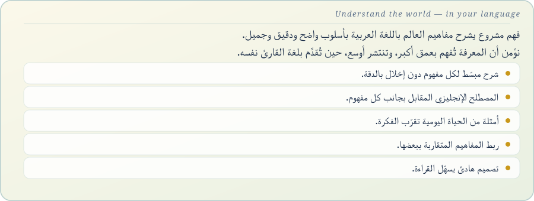
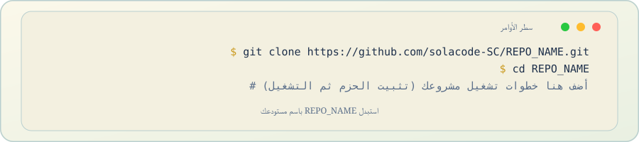
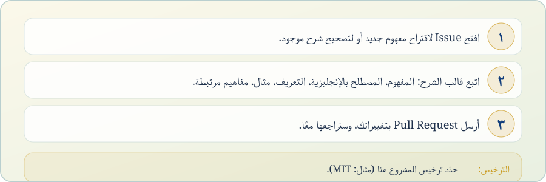

<!-- Hero art: lotus-pond painting (artist/source unknown). Replace art/source.jpg with an image you have the right to use. -->

<picture>
  <source media="(prefers-color-scheme: dark)" srcset="assets/hero-dark.svg">
  <source media="(prefers-color-scheme: light)" srcset="assets/hero-light.svg">
  
</picture>

<picture>
  <source media="(prefers-color-scheme: dark)" srcset="assets/banner-about-dark.svg">
  <source media="(prefers-color-scheme: light)" srcset="assets/banner-about-light.svg">
  
</picture>

<picture>
  <source media="(prefers-color-scheme: dark)" srcset="assets/about-content-dark.svg">
  <source media="(prefers-color-scheme: light)" srcset="assets/about-content-light.svg">
  
</picture>

<picture>
  <source media="(prefers-color-scheme: dark)" srcset="assets/banner-fields-dark.svg">
  <source media="(prefers-color-scheme: light)" srcset="assets/banner-fields-light.svg">
  
</picture>

<picture>
  <source media="(prefers-color-scheme: dark)" srcset="assets/fields-dark.svg">
  <source media="(prefers-color-scheme: light)" srcset="assets/fields-light.svg">
  
</picture>

<picture>
  <source media="(prefers-color-scheme: dark)" srcset="assets/banner-how-dark.svg">
  <source media="(prefers-color-scheme: light)" srcset="assets/banner-how-light.svg">
  
</picture>

<picture>
  <source media="(prefers-color-scheme: dark)" srcset="assets/steps-dark.svg">
  <source media="(prefers-color-scheme: light)" srcset="assets/steps-light.svg">
  
</picture>

<picture>
  <source media="(prefers-color-scheme: dark)" srcset="assets/banner-sample-dark.svg">
  <source media="(prefers-color-scheme: light)" srcset="assets/banner-sample-light.svg">
  
</picture>

<picture>
  <source media="(prefers-color-scheme: dark)" srcset="assets/sample-dark.svg">
  <source media="(prefers-color-scheme: light)" srcset="assets/sample-light.svg">
  
</picture>

<picture>
  <source media="(prefers-color-scheme: dark)" srcset="assets/banner-start-dark.svg">
  <source media="(prefers-color-scheme: light)" srcset="assets/banner-start-light.svg">
  
</picture>

<picture>
  <source media="(prefers-color-scheme: dark)" srcset="assets/quickstart-content-dark.svg">
  <source media="(prefers-color-scheme: light)" srcset="assets/quickstart-content-light.svg">
  
</picture>

<picture>
  <source media="(prefers-color-scheme: dark)" srcset="assets/banner-contribute-dark.svg">
  <source media="(prefers-color-scheme: light)" srcset="assets/banner-contribute-light.svg">
  
</picture>

<picture>
  <source media="(prefers-color-scheme: dark)" srcset="assets/contribute-content-dark.svg">
  <source media="(prefers-color-scheme: light)" srcset="assets/contribute-content-light.svg">
  
</picture>

<picture>
  <source media="(prefers-color-scheme: dark)" srcset="assets/footer-dark.svg">
  <source media="(prefers-color-scheme: light)" srcset="assets/footer-light.svg">
  
</picture>

